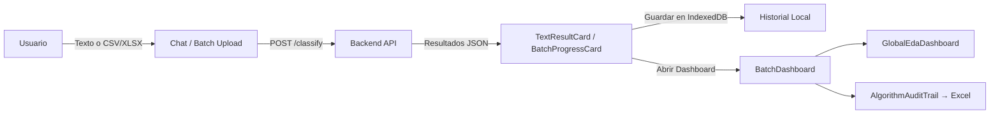

# Social Debt Frontend Model

Una interfaz de usuario moderna e interactiva para detectar, clasificar y visualizar la **Deuda Social** (_Social Debt_) en conversaciones, discusiones de código y comunidades de desarrollo de software.

Este proyecto actúa como el front-end principal para un modelo de clasificación de Deuda Social, proporcionando herramientas visuales para el análisis tanto de texto individual como de conjuntos de datos masivos (`.csv` / `.xlsx`), con dashboards avanzados, historial local persistente y soporte para clasificación en lote.

---

## ✨ Características Principales

- 💬 **Interfaz de Chat Interactiva:** Analiza comentarios de texto individualmente para detectar macrocausas, microcausas, riesgos de deuda social y _community smells_, con visualización responsiva optimizada para móvil y escritorio.
- 📊 **Procesamiento en Lote (Batch):** Sube archivos `.csv` o `.xlsx` estructurados para clasificar cientos de comentarios de forma asíncrona, con barra de progreso y cancelación en tiempo real.
- 📈 **Dashboard de Métricas EDA Global:** Visualiza distribuciones de macrocausas, Top N de microcausas, riesgos y estrategias, heatmaps de co-ocurrencias, y el Índice de Deuda Social (SDI) a nivel de issue y global.
- 🔬 **Audit Trail del Algoritmo:** Exporta un reporte Excel completo con múltiples hojas (métricas SDI, comparativa de modelos, indicadores, efectos, tipos de microcausa) para revisión académica o de equipo.
- 🗂️ **Historial Local Persistente:** Todo el historial de análisis e interacciones se guarda localmente en el navegador usando IndexedDB — sin servidor, sin telemetría, 100% privado.
- 🎨 **Diseño Premium (Glassmorphism + Responsive):** Estética moderna con modo glassmorphism, animaciones fluidas, diseño responsivo completo (Mobile & PC), y paleta de colores optimizada para legibilidad.
- 🧠 **Ontología de Deuda Social:** Diccionario de ontología integrado con más de 1,200 entradas para microcausas, estrategias preventivas/correctivas, riesgos, efectos, indicadores y métricas.

---

## 🛠️ Stack Tecnológico

| Capa                          | Tecnología                                                                                           |
| ----------------------------- | ---------------------------------------------------------------------------------------------------- |
| **Framework Core**            | [Next.js 16](https://nextjs.org/) (App Router) + [React 19](https://react.dev/)                      |
| **Estilos**                   | [Tailwind CSS v4](https://tailwindcss.com/)                                                          |
| **Iconografía**               | [Lucide React](https://lucide.dev/)                                                                  |
| **Visualización**             | [Recharts](https://recharts.org/) + [Nivo](https://nivo.rocks/) (Heatmaps)                           |
| **Procesamiento de Archivos** | [PapaParse](https://www.papaparse.com/) (CSV) + [ExcelJS](https://github.com/exceljs/exceljs) (XLSX) |
| **Animaciones**               | [Framer Motion](https://www.framer.com/motion/)                                                      |
| **Almacenamiento Local**      | `idb-keyval` (IndexedDB)                                                                             |
| **Calidad de Código**         | ESLint + TypeScript estricto                                                                         |

---

## 📦 Estructura del Proyecto

```text
src/
├── app/                              # Layout, estilos globales y página principal (Next.js App Router)
│   ├── globals.css                   # Tailwind v4, temas y utilidades globales
│   ├── layout.tsx                    # RootLayout con fuentes y metadata
│   ├── not-found.tsx                 # Redirección de rutas 404
│   └── page.tsx                      # Orquestador del feed interactivo y dashboard
├── features/                         # Módulos de dominio y casos de uso
│   ├── analytics-dashboard/          # Visualización de métricas, gráficos e informes
│   │   ├── BatchDashboard.tsx        # Contenedor con navegación por pestañas del análisis
│   │   ├── global-view/              # Pestaña Global (frecuencias, heatmaps EDA, caminos críticos)
│   │   ├── issue-view/               # Pestaña Issue-Level (SDI, desglose de causas y comentarios)
│   │   └── traceability-view/        # Pestaña Trazabilidad (auditoría algorítmica y exportación Excel)
│   ├── dataset-inspection/           # Inspección previa y validación de archivos de entrada
│   │   ├── useFileValidation.ts      # Hook de validación de encabezados CSV/XLSX y orfandad
│   │   └── ValidationChecklistModal.tsx # Modal interactivo con checklist y selector de estrategia
│   ├── history/                      # Persistencia y gestión del historial local
│   │   ├── historyDB.ts              # Almacenamiento local en IndexedDB con versionado de caché
│   │   └── HistorySidebar.tsx        # Barra lateral de historial, selección y descarga
│   ├── ontology-catalog/             # Catálogo de entidades ontológicas de deuda social
│   │   ├── frontend_ontology_dictionary.json # Diccionario (+1,200 entidades)
│   │   └── useOntology.ts            # Hook para consulta flexible de descripciones y taxonomía
│   └── social-debt-engine/           # Comunicación con backend y componentes del motor
│       ├── batch-actions.ts          # Server Actions para jobs en lote, estados y límites
│       ├── text-actions.ts           # Server Action para clasificación de texto individual
│       └── components/               # Tarjetas de progreso, resumen, límites y desglose
└── shared/                           # Componentes transversales de la aplicación
    ├── ChatInput.tsx                 # Barra inferior de redacción y carga de archivos
    └── ChatLayout.tsx                # Shell estructural con soporte responsive y drawer
```

---

## ⚙️ Requisitos Previos

- **Node.js** 18.x o superior
- **npm** (o `yarn` / `pnpm`)
- Servidor de backend de clasificación corriendo (ver configuración de entorno)

---

## 🚀 Configuración y Ejecución

### 1. Variables de Entorno

Copia la plantilla `.env.example` a `.env` en la raíz del proyecto:

```bash
cp .env.example .env
```

El archivo `.env` contiene las siguientes variables:

```env
PROJECT_NAME="Social Debt Model"
API_V1_STR="/api/v1"
API_SECRET_KEY="tu_clave_secreta"
API_URL="http://localhost:8000/api/v1"
NEXT_PUBLIC_API_URL="http://localhost:8000/api/v1"
```

> **Nota:**
>
> - `NEXT_PUBLIC_API_URL` / `API_URL`: URL base del backend de la API del modelo (incluyendo el prefijo `/api/v1`).
> - `API_SECRET_KEY`: Clave de autenticación para la cabecera `X-API-Key`.
> - `API_V1_STR`: Sufijo de versión de la API.
> - `PROJECT_NAME`: Nombre descriptivo del proyecto.

### 2. Instalación y Ejecución

```bash
# Instalar dependencias
npm install

# Iniciar servidor de desarrollo
npm run dev
```

La aplicación estará disponible en [http://localhost:3000](http://localhost:3000).

---

## 📜 Scripts Disponibles

```bash
npm run dev      # Modo desarrollo con hot-reload
npm run build    # Compilación de producción optimizada
npm run start    # Servidor de producción (requiere build previo)
npm run lint     # Análisis estático con ESLint (0 errores tolerados)
```

---

## 🗺️ Flujo de Uso



---

## 📄 Licencia

Este proyecto es parte de una investigación académica sobre Deuda Social en comunidades de software. Todos los derechos reservados.
